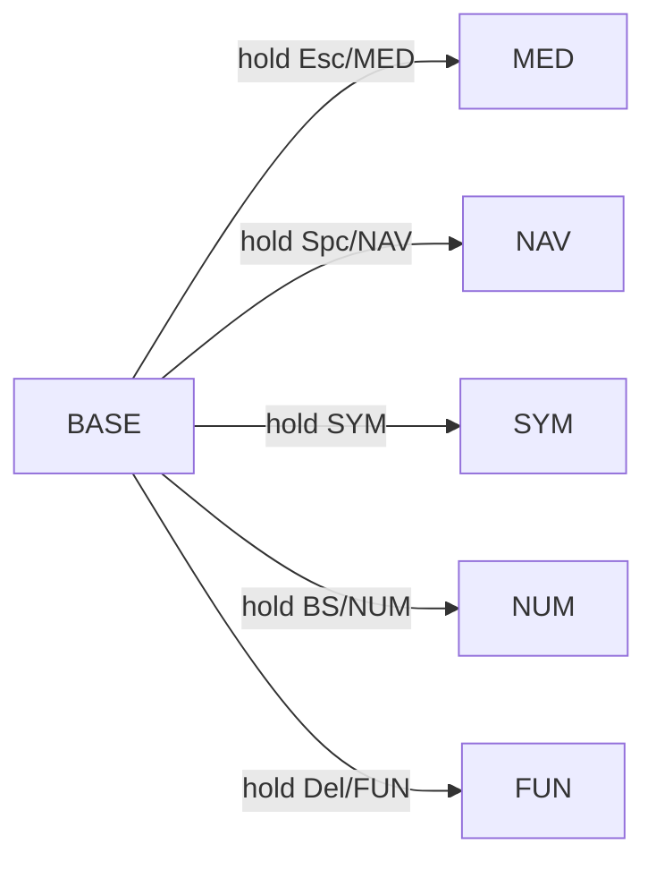

# Keymaps

One shared 5-column core (`users/mgallecom/mgallecom.h`) drives both boards. Combos live in
`users/mgallecom/combos.h`. Board folders only add the outer keys, thumb wiring and extras.

- **BM40** (`kprepublic/bm40hsrgb/rev1`): 12x4 ortholinear, two unused centre keys per row.
- **Corne** (`crkbd/r2g`): 3x6 + 3 thumbs per half, OLED.

Legend: `A/Win` = tap `A`, hold Gui (Ctrl on macOS, the ctrl and gui keys are swapped there).
`(hold)` = the key you are holding to be on this layer. `---` = nothing.

## Layers



## Base

### BM40

```
╭────────┬────────┬────────┬────────┬────────┬────────┬────────┬────────┬────────┬────────┬────────┬────────╮
│   Q    │   W    │   E    │   R    │   T    │ OS tgl │  ---   │   Y    │   U    │   I    │   O    │   P    │
├────────┼────────┼────────┼────────┼────────┼────────┼────────┼────────┼────────┼────────┼────────┼────────┤
│ A/Win  │ S/Alt  │ D/Ctl  │ F/Sft  │   G    │  ---   │  ---   │   H    │ J/Sft  │ K/Ctl  │ L/Alt  │ '/Win  │
├────────┼────────┼────────┼────────┼────────┼────────┼────────┼────────┼────────┼────────┼────────┼────────┤
│ Z/Hypr │   X    │   C    │   V    │ B/Meh  │  ---   │  ---   │ N/Meh  │   M    │   ,    │   .    │ //Hypr │
├────────┼────────┼────────┼────────┼────────┼────────┴────────┼────────┼────────┼────────┼────────┼────────┤
│ ScrCap │  ---   │Esc/MED │Spc/NAV │  Tab   │     Alfred      │  SYM   │ BS/NUM │Del/FUN │  ---   │  ---   │
╰────────┴────────┴────────┴────────┴────────┴─────────────────┴────────┴────────┴────────┴────────┴────────╯
```

`OS tgl` switches between Windows and macOS mode (also auto-detected). `ScrCap` is the cross-platform
screenshot. `Alfred` sends Alt+Space.

### Corne

```
╭────────┬────────┬────────┬────────┬────────┬────────╮   ╭────────┬────────┬────────┬────────┬────────┬────────╮
│  ---   │   Q    │   W    │   E    │   R    │   T    │   │   Y    │   U    │   I    │   O    │   P    │  ---   │
├────────┼────────┼────────┼────────┼────────┼────────┤   ├────────┼────────┼────────┼────────┼────────┼────────┤
│  ---   │ A/Win  │ S/Alt  │ D/Ctl  │ F/Sft  │   G    │   │   H    │ J/Sft  │ K/Ctl  │ L/Alt  │ '/Win  │  ---   │
├────────┼────────┼────────┼────────┼────────┼────────┤   ├────────┼────────┼────────┼────────┼────────┼────────┤
│ ScrCap │ Z/Hypr │   X    │   C    │   V    │ B/Meh  │   │ N/Meh  │   M    │   ,    │   .    │ //Hypr │  ---   │
╰────────┴────────┴────────┼────────┼────────┼────────┤   ├────────┼────────┼────────┴────────┴────────┴────────╯
                           │Esc/MED │Spc/NAV │  Tab   │   │  SYM   │ BS/NUM │Del/FUN │
                           ╰────────┴────────┴────────╯   ╰────────┴────────┴────────╯
```

## Other layers (shared core)

Left and right halves, thumbs underneath. Outer keys per board are listed below each diagram.

### Number (BS/NUM)

```
╭────────┬────────┬────────┬────────┬────────╮   ╭────────┬────────┬────────┬────────┬────────╮
│   =    │   7    │   8    │   9    │   *    │   │  ---   │  ---   │  ---   │  ---   │  Bksp  │
├────────┼────────┼────────┼────────┼────────┤   ├────────┼────────┼────────┼────────┼────────┤
│   :    │   4    │   5    │   6    │   -    │   │  ---   │ Shift  │  Ctrl  │  Alt   │  Gui   │
├────────┼────────┼────────┼────────┼────────┤   ├────────┼────────┼────────┼────────┼────────┤
│   /    │   1    │   2    │   3    │   +    │   │  ---   │  ---   │  ---   │ AltGr  │  ---   │
╰────────┴────────┼────────┼────────┼────────┤   ├────────┼────────┼────────┼────────┴────────╯
                  │   .    │   0    │   ,    │   │  ---   │ (hold) │  ---   │
                  ╰────────┴────────┴────────╯   ╰────────┴────────┴────────╯
```

Corne: extra `Bksp` on the right outer column, top row.

### Symbol (SYM)

```
╭────────┬────────┬────────┬────────┬────────╮   ╭────────┬────────┬────────┬────────┬────────╮
│   |    │   &    │   *    │   \    │   [    │   │   ]    │  ---   │  ---   │  ---   │  Bksp  │
├────────┼────────┼────────┼────────┼────────┤   ├────────┼────────┼────────┼────────┼────────┤
│   :    │   $    │   %    │   ^    │   (    │   │   )    │ Shift  │  Ctrl  │  Alt   │  Gui   │
├────────┼────────┼────────┼────────┼────────┤   ├────────┼────────┼────────┼────────┼────────┤
│   ~    │   !    │   @    │   #    │   {    │   │   }    │  ---   │  ---   │ AltGr  │  ---   │
╰────────┴────────┼────────┼────────┼────────┤   ├────────┼────────┼────────┼────────┴────────╯
                  │   ;    │   -    │   _    │   │ (hold) │   -    │  ---   │
                  ╰────────┴────────┴────────╯   ╰────────┴────────┴────────╯
```

The brackets are plain keys here (fallback to the combos below), mirrored on the inner columns of both
hands. Corne: extra `Bksp` on the right outer column, top row.

### Navigation (Spc/NAV)

```
╭────────┬────────┬────────┬────────┬────────╮   ╭────────┬────────┬────────┬────────┬────────╮
│  Save  │ Paste  │  Copy  │  Cut   │  Undo  │   │  ---   │ Word ← │  ---   │  ---   │ Word → │
├────────┼────────┼────────┼────────┼────────┤   ├────────┼────────┼────────┼────────┼────────┤
│  Gui   │  Alt   │  Ctrl  │ Shift  │  ---   │   │   ←    │   ↓    │   ↑    │   →    │  Caps  │
├────────┼────────┼────────┼────────┼────────┤   ├────────┼────────┼────────┼────────┼────────┤
│  ---   │  ---   │  ---   │  ---   │  ---   │   │  Home  │  PgDn  │  PgUp  │  End   │  Ins   │
╰────────┴────────┼────────┼────────┼────────┤   ├────────┼────────┼────────┼────────┴────────╯
                  │  ---   │ (hold) │  ---   │   │ Enter  │ Wd Bsp │ Wd Del │
                  ╰────────┴────────┴────────╯   ╰────────┴────────┴────────╯
```

Plain modifiers on the left home row: hold Space, hold Shift, press `Enter` for Shift+Enter without any
tap-hold timing. `Paste` double-tapped opens the Alfred clipboard history.

### Function (Del/FUN)

```
╭────────┬────────┬────────┬────────┬────────╮   ╭────────┬────────┬────────┬────────┬────────╮
│  F12   │   F7   │   F8   │   F9   │ PrtSc  │   │  ---   │  ---   │  ---   │  ---   │  BOOT  │
├────────┼────────┼────────┼────────┼────────┤   ├────────┼────────┼────────┼────────┼────────┤
│  F11   │   F4   │   F5   │   F6   │  ---   │   │  ---   │ Shift  │  Ctrl  │  Alt   │  Gui   │
├────────┼────────┼────────┼────────┼────────┤   ├────────┼────────┼────────┼────────┼────────┤
│  F10   │   F1   │   F2   │   F3   │ Pause  │   │  ---   │  ---   │  ---   │ AltGr  │  ---   │
╰────────┴────────┼────────┼────────┼────────┤   ├────────┼────────┼────────┼────────┴────────╯
                  │  Menu  │ Space  │  Tab   │   │  ---   │  ---   │ (hold) │
                  ╰────────┴────────┴────────╯   ╰────────┴────────┴────────╯
```

Corne: extra `BOOT` on the right outer column, top row.

### Media (Esc/MED)

```
╭────────┬────────┬────────┬────────┬────────╮   ╭────────┬────────┬────────┬────────┬────────╮
│  ---   │  ---   │  ---   │  ---   │  ---   │   │ RGB on │ RGB mod│ Hue +  │ Sat +  │ Val +  │
├────────┼────────┼────────┼────────┼────────┤   ├────────┼────────┼────────┼────────┼────────┤
│  Gui   │  Alt   │  Ctrl  │ Shift  │  ---   │   │  ---   │  Prev  │ Vol -  │ Vol +  │  Next  │
├────────┼────────┼────────┼────────┼────────┤   ├────────┼────────┼────────┼────────┼────────┤
│  ---   │  ---   │  ---   │  ---   │  ---   │   │  ---   │  ---   │ Brgt - │ Brgt + │  ---   │
╰────────┴────────┼────────┼────────┼────────┤   ├────────┼────────┼────────┼────────┴────────╯
                  │ (hold) │  ---   │  ---   │   │  Stop  │  Play  │  Mute  │
                  ╰────────┴────────┴────────╯   ╰────────┴────────┴────────╯
```

Corne: `BOOT` on the left outer column and `OS tgl` on the right outer column, top row. The RGB keys do
nothing on the Corne (RGB matrix is off there).

## Combos

All combos are base-layer chords in `users/mgallecom/combos.h`, identical on both boards. Each chord is a
pair of neighbouring keys that almost never meet in German or English words, so rolling over them while
typing does not trigger them. `COMBO_TERM` is 35 ms.

| Output | Chord | Fingers | Shifted partner |
|---|---|---|---|
| Enter | `,` + `.` | right middle + ring, bottom row | hold Shift (`F`) then chord = Shift+Enter |
| `(` | `D` + `F` | left middle + index, home row | |
| `)` | `J` + `K` | right index + middle, home row | |
| `[` | `C` + `V` | left middle + index, bottom row | hold Shift (`J`) = `{` |
| `]` | `M` + `,` | right index + middle, bottom row | hold Shift (`F`) = `}` |
| `;` | `Z` + `X` | left pinky + ring, bottom row | hold Shift (`J`) = `:` |

Corne only: `I` + `O` = `-`, `S` + `D` = Alfred (Alt+Space).

- **Shift:** use the home-row Shift on the *other* hand (it is a mod-tap, so hold it past the 200 ms
  tapping term, same as for capital letters).
- **Mod-tap chords** (`D`+`F`, `J`+`K`, `Z`+`X`) fire on tap only. Holding them still gives
  Ctrl+Shift, Shift+Ctrl and Hyper+... as before.
- **Where it might misfire:** `M` + `,` (word-final "m," like "dem,"), `D` + `F` (compounds like
  "Handfläche"), `,` + `.` ("e.g.,"). If one bothers you, raise or lower `COMBO_TERM` in
  `users/mgallecom/config.h`, or move that combo to another pair in `combos.h`.
- **Fallbacks:** all brackets, `;` and `:` also exist as plain keys on the SYM layer, and Enter is on the
  NAV layer thumb.
